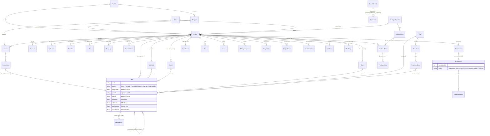

# PM CONTROL TOWER — "The Command Center"
## Product Requirements, System Architecture & Database Schema (v3.0)

**Owner:** Transformation Director's office · **Codename:** The Command Center
**Status:** Implemented core (v3.0) — this document maps the 40-app mega-scope onto what the platform now does, what was added in v3.0, and the reference architecture for scale-out.

---

## 0. Executive Summary

PM Control Tower began as an enterprise PPM platform (Portfolio → Program → Project → WBS → Schedule → EVM → Governance → Leadership Reporting). This release (v3.0, "Command Center expansion") closes the gaps against the omni-functional mega-scope by adding **Agile/Scrum delivery, omni task views (Kanban/Calendar/Workload), product strategy (feedback voting + roadmap), knowledge workspace (docs + message boards), commercial operations (clients, invoices, expenses), construction field ops (RFIs, daily logs, punch list, BIM link-out), and asset proofing & approvals** — all on the single existing `Project/Task` core, with no duplicated data.

### Capability coverage vs the mega-prompt clusters

| # | Cluster (source apps) | Coverage | Where |
|---|---|---|---|
| 1 | Core Workflow & Task Engine — omni views (ClickUp, Monday) | ✅ | List/Table (Tasks, Register), Kanban + Calendar + Workload (**v3.0** `/boards`), Timeline (Schedule/Gantt), Tree (WBS), personal Planner. Map & Whiteboard: roadmap items (see §6). |
| 1 | Hierarchical structuring (Quire, Zenkit) + quick-add + calendar sync (Todoist, Any.do, Freedcamp) | ✅ | Unlimited `Task`/`WBSNode` parent trees; meetings/tasks surface in Calendar; ICS feed = roadmap item. |
| 1 | Relational low-code backbone (Airtable, Smartsheet, Podio, Kissflow) | ✅ | Metadata layer v1.9: `EntityDefinition`, `CustomFieldType` (incl. FORMULA), `FieldDefinition`, Terminology, NamingConvention. |
| 1 | Predictive management (Wrike) + probabilistic scheduling (LiquidPlanner) | ✅ | Monte Carlo `SimulationRun`, PERT `TaskEstimate`, `CalibrationFactor`, `ScheduleScenario`, `Scenario` sandbox. |
| 1 | Communication hub (Basecamp) | ✅ **v3.0** | `/boards-hub` Message Boards (`BoardThread` + generic `Comment`), Notifications, Work Inbox, @mentions. |
| 2 | Keyboard-first speed (Linear) | ✅ | ⌘K command palette, global search, quick-create, hash routing. |
| 2 | Issue & sprint tracking (Jira, Shortcut, Pivotal Tracker, Taiga, YouTrack) | ✅ **v3.0** | `/agile`: `Sprint`, `Epic`, `storyPoints`, backlog grooming, drag-and-drop sprint board; RAID `Issue` register for non-agile issues. |
| 2 | Native code sync (GitHub Projects, GitLab) | ⚙️ Partial | Integration Hub + webhooks + `TechRelease` (CTO Tower) provide the conduit; PR/commit auto-linking is a connector away (roadmap §6). |
| 2 | Enterprise portfolio Kanban (Businessmap/Kanbanize) | ✅ **v3.0** | Cross-project Kanban on `/boards` (status lanes across all projects) + Prioritization optimizer. |
| 3 | Docs-first workspace (Notion, Coda) | ✅ **v3.0** | `/docs`: spaces → markdown pages with tables, search, edit/preview. |
| 3 | Product strategy (Aha!, Productboard) | ✅ **v3.0** | `/feedback`: portal with 1-user-1-vote, triage workflow, `RoadmapItem` quarters linked to feedback + projects. |
| 4 | Integrated proofing (Filestage, ProofHub) | ✅ **v3.0** | `/proofing`: versioned `ProofRound`s on `Deliverable` + `ProofAnnotation` markup notes, approve / changes-requested decisions. |
| 4 | Creative operations (Adobe Workfront, Hive) | ✅ | Proofing + Approval chains + Deliverables + resource allocation views. |
| 5 | Financial tracking (Zoho Projects, Hubstaff Tasks) | ✅ | Timesheets, BudgetLines, EVM, cost/billable rates, finance engine. |
| 5 | Client management (ActiveCollab, Teamwork, Paymo, Harvest) | ✅ **v3.0** | `/clients`: `Client` register, `Invoice`+lines (DRAFT→SENT→PAID, locked when paid), `Expense` approvals — tied to projects & milestones. |
| 6 | Advanced scheduling (TeamGantt, GanttPRO, MS Project, ProjectManager) | ✅ | CPM engine (ES/EF/LS/LF, floats, critical path), lag/lead `Dependency`, `Baseline` snapshot/activate, enterprise Gantt. |
| 6 | Field & BIM (Autodesk Construction Cloud, Procore) | ✅ **v3.0** | `/field`: `Rfi` (aging + cost/schedule impact), `DailyLog` site diary, `PunchListItem` closeout, BIM viewer embed (iframe URL → ACC/model service). |
| 6 | ERP-grade capital ops (Oracle Primavera, InEight, CMiC, Buildertrend) | ✅ | EVM, baselines, contracts via `Vendor` + invoices (**v3.0**), governance rules; full GL integration remains an ERP-connector concern. |

**Still on the roadmap (explicitly out of v3.0):** freeform whiteboard & geographic map views, bi-directional GitHub/GitLab commit→task automation, native ERP GL posting, ICS outbound feed. These are connector/view layers over the same schema (§6), not schema changes.

---

## 1. System Architecture (text diagram)

Current implementation is a **modular monolith** (single Next.js app + SQLite/Postgres + Socket.IO sidecar) — deliberately: one deployable, one truth. The architecture below shows both the running system (solid) and the scale-out path (dashed).

```
┌──────────────────────────────────────────────────────────────────────────────┐
│  CLIENTS  (dark-theme SPA, keyboard-first)                                   │
│  Next.js 16 App Router · React 19 · TanStack-style useApi hook · dnd-kit     │
│  Hash-routed single page: registry → lazy view modules (~35 views)           │
└───────────────┬──────────────────────────────────────────────────────────────┘
                │ HTTPS (Bearer JWT)                │ WSS (socket.io-client)
┌───────────────▼───────────────────────────┐  ┌──▼───────────────────────────┐
│  NEXT.JS APP (standalone Node/Bun)        │  │  REALTIME SERVICE             │
│  ┌─────────────────────────────────────┐  │  │  mini-services/realtime       │
│  │ API LAYER  /src/app/api/**          │  │  │  Socket.IO :3003              │
│  │  withApi() = auth→RBAC→zod→handler  │◄─┼──┤  rooms: project:<id>          │
│  │  +audit +rateLimit +ApiError        │  emit │  role:<code> user:<id> global │
│  │  ~60 route groups (incl. v3.0:      │  │  └───────────────────────────────┘
│  │   agile clients invoices expenses   │  │
│  │   rfis daily-logs punch-list        │  │
│  │   feedback roadmap docs boards      │  │
│  │   message-boards proofing)          │  │
│  └──────────────┬──────────────────────┘  │
│  ┌──────────────▼──────────────────────┐  │
│  │ DOMAIN ENGINES  /src/lib/engines    │  │
│  │  cpm · evm · montecarlo · governance│  │
│  │  health · rollup · finance ·        │  │
│  │  prioritization · executive-portfolio│ │
│  │  benefits · scenario · calibration  │  │
│  │  freshness · evidence · timesheet   │  │
│  │  automations · connectors · identity│  │
│  └──────────────┬──────────────────────┘  │
│  ┌──────────────▼──────────────────────┐  │
│  │ PRISMA ORM (SQLite dev / PG prod)   │  │
│  │  ~70 models — see §3                │  │
│  └──────────────┬──────────────────────┘  │
└─────────────────┼─────────────────────────┘
                  │
     ┌────────────▼────────────┐   ┌──────────────────────────────────┐
     │ DATABASE                │   │ OUTBOUND CONNECTORS (roadmap)     │
     │ db/custom.db (sandbox)  │   │ GitHub/GitLab commits & PRs →     │
     │ PostgreSQL (Render)     │   │   task status · ERP GL posting ·  │
     └─────────────────────────┘   │ SMTP · ICS calendar · BIM/ACC API │
                                   └──────────────────────────────────┘

Scale-out path (dashed, no schema change):
  API layer → extract per bounded context (AgileSvc, FieldSvc, CommerceSvc,
  KnowledgeSvc) behind the existing route contract; engines become workers
  (BullMQ/cron) — CPM & Monte Carlo are already CPU-isolated; Prisma schema
  is the integration contract until services split.
```

**Why this holds up:** every feature added in v3.0 reuses the same `withApi` pipeline (JWT auth → RBAC permission → zod validation → Prisma → audit trail → realtime emit), so a software engineer's Kanban move, a finance controller's invoice approval, and a field engineer's RFI answer all get identical security, auditability, and live fan-out.

---

## 2. Modular PRD — one entity, many faces

The Command Center principle: **a single `Task` row is the atom**; each module is a *lens* over it (plus module-specific satellites). No module owns a private copy of work.

| Module (route) | Persona lens | Reads / writes |
|---|---|---|
| **Executive Control Tower** `/dashboard` | Director | Roll-ups of everything below |
| **Portfolio & Prioritization** `/portfolios` `/programs` `/prioritization` | Portfolio manager | `Portfolio`, `Program`, `Project`, `ProjectScore`, optimizer scenarios |
| **Plan (Register/Requirements/WBS/Tasks/Schedule/Milestones/Baselines)** | PM (waterfall) | `Task`, `WBSNode`, `Dependency`, `Milestone`, `Baseline`, CPM engine |
| **Agile Delivery** `/agile` *(v3.0)* | Scrum team | Same `Task` + `storyPoints`, `Sprint`, `Epic`; Kanban moves update status → CPM/EVM see it |
| **Boards** `/boards` *(v3.0)* | Anyone | Same `Task` as Kanban / Calendar / Workload heatmap (`/api/capacity`) |
| **Execute (Resources/Timesheets/Inbox/Planner)** | Team member | `Resource`, `Assignment`, `TimesheetEntry` → task actuals |
| **Control (Financials/Investment/EVM/Health/RAID/Changes/Gates/Governance/Integrity)** | PMO, Finance | `BudgetLine`, `EvmPeriod`, `Risk`…, governance rules → alerts |
| **Clients & Billing** `/clients` *(v3.0)* | Finance controller | `Client`, `Invoice`(+lines, milestone-tied), `Expense` (approval workflow) |
| **Field Operations** `/field` *(v3.0)* | Construction lead | `Rfi`, `DailyLog`, `PunchListItem`, BIM embed |
| **Strategy & Knowledge** `/feedback` `/docs` `/boards-hub` *(v3.0)* | Product owner, all | `FeedbackPost`+votes, `RoadmapItem`, `DocPage`, `BoardThread`+`Comment` |
| **Proofing & Approvals** `/proofing` *(v3.0)* | Reviewers | `ProofRound`, `ProofAnnotation` on `Deliverable` |
| **Connect (Integrations/Automations/Webhooks/AI)** | Admin | `Integration`, `AutomationRule`, `WebhookSubscription`, `AIConnector` |
| **Admin (Users/Roles/Templates/Audit/Config)** | Admin | RBAC (43 permissions, 8 role templates), `AuditEvent` |

**Data-flow examples (no duplication):**
- Engineer drags card *In Progress → Completed* in `/agile` → `PATCH /api/agile` → Task.status/progress updated → sprint points recomputed → realtime `agile:changed` → PM's Gantt + EVM roll-up refresh on next read; timesheet actuals still feed AC.
- Client signs milestone → Finance marks invoice `PAID` in `/clients` → invoice lines linked to milestone/tasks keep revenue traceable to delivery.
- Field RFI answered with `scheduleImpactDays: 2` → surfaces in the RFI aging register; PM raises the matching `ChangeRequest` in Control — same project, same audit trail.
- Feedback post crosses 10 votes → triaged `PLANNED` → linked to a `RoadmapItem` in a quarter → optionally promoted to a `Project` intake.

---

## 3. Core Entity-Relationship Schema

The morphing atom: **Task** carries agile fields (`sprintId`, `epicId`, `storyPoints`), schedule fields (CPM floats, constraints), commercial hooks (via invoice lines `taskId`), and code-sync hooks (`externalRef` on `Dependency`). Satellites hang off `Project`/`Deliverable`.



Markdown-table form of the v3.0 additions:

| Model | Key fields | Notes |
|---|---|---|
| `Sprint` | projectId, name, goal, status(PLANNED/ACTIVE/COMPLETED), startDate, endDate, committedPoints | One ACTIVE sprint enforced per project; committedPoints server-recomputed |
| `Epic` | projectId, code, name, colorHex, status, businessValue | Themes across sprints |
| `Task` *(extended)* | + sprintId?, epicId?, storyPoints, backlogOrder | FK SetNull — deleting a sprint/epic never loses tasks |
| `Client` | name, organization, contact, status(PROSPECT/ACTIVE/ON_HOLD/CHURNED), portalUrl | Delete blocked while invoices exist |
| `Invoice` / `InvoiceLine` | number unique, status(DRAFT/SENT/PAID/OVERDUE/VOID), taxPct, subtotal/tax/total server-computed; lines qty × unitPrice | PAID is locked (must VOID first); paidAt stamped |
| `Expense` | projectId, category, amount, billable, status(PENDING/APPROVED/REJECTED/REIMBURSED), approvedByName | Approver stamped server-side |
| `Rfi` | rfiCode unique-per-project, discipline, status(DRAFT/OPEN/ANSWERED/CLOSED), dateOpened/Answered, costImpact, scheduleImpactDays | Code auto-generated RFI-#### |
| `DailyLog` | logDate, weather, crewCount, workPerformed, delays, safetyIncidents | Field diary |
| `PunchListItem` | code unique-per-project, severity, status(OPEN/IN_PROGRESS/CLOSED/VERIFIED), closedAt | Closeout verification chain |
| `FeedbackPost` / `FeedbackVote` | votesCount (denormalized), status triage; vote unique(postId, voterKey) | One-user-one-vote, toggle |
| `RoadmapItem` | quarter (e.g. 2026-Q4), status, progress, releaseTag, projectId?, objectiveId? | Linked feedback count derived |
| `DocPage` | space (6 fixed), markdown content, tags, parentId, isPublished | Search over title+content |
| `BoardThread` / `Comment` | thread.category, pinned, replyCount, lastActivityAt; comment uses generic entityType="BOARD_THREAD" | Reuses the platform comment primitive |
| `ProofRound` / `ProofAnnotation` | roundNumber auto-increment per deliverable, versionLabel, status; annotation locator (page/timecode), xPct/yPct, resolved | Version chain per deliverable |

---

## 4. UI/UX — Dark-theme Command Center navigation

The shell keeps the navy `#0b1f3a` sidebar + light content canvas, ⌘K palette, quick-create, notification bell, all-tabs PDF export. v3.0 adds one nav group and slots the rest into existing groups (permission-filtered so the sidebar never shows what a role can't open):

```
EXECUTIVE          Executive Control Tower
PORTFOLIO          Portfolios · Programs · Projects
PLAN               Project Register · Requirements · WBS · Tasks
                   ★ Agile Delivery (sprints/backlog/epics)
                   Schedule (Gantt) · Milestones · Baselines
EXECUTE            ★ Boards (Kanban · Calendar · Workload)
                   Resources · Timesheets · Work Inbox · Focus Planner
CONTROL            Financials · ★ Clients & Billing · ★ Field Operations
                   Investment & Business Case · EVM · Health · RAID
                   Change Control · Stage Gates · Governance · Data Integrity
                   CTO Tower · Prioritization
STRATEGY & KNOWLEDGE (new group)
                   ★ Feedback & Roadmap · ★ Docs & Knowledge
                   ★ Message Boards · ★ Proofing & Approvals
INTELLIGENCE       Leadership Tower · Reports · Reporting Center · Analytics · AI Assistant
CONNECT            Integration Hub · Automations · Notifications · Webhooks
                   AI Gateway · Extension Hub
ADMINISTRATION     Users · Roles · Templates · Audit · Control Center · Configuration
                   (★ = v3.0)
```

**Anti-clutter rules that keep 15+ views navigable:**
1. **Permission-gated nav** — e.g. `docs.use`/`boards.use` hide for roles without them; `client.manage` gates mutations, `financial.view` gates visibility.
2. **One project context, shared** — plan/control views persist the selected project (`pmct.plan.project`) so Agile, Boards, Field Ops, Proofing stay in sync; each view renders the picker in its header.
3. **Tabs over pages** — module sub-surfaces (Kanban/Calendar/Workload; RFIs/Logs/Punch/BIM; Clients/Invoices/Expenses; Feedback/Roadmap) are tabs inside one route, one fetch family.
4. **Same-entity views are re-renders, not copies** — Kanban, Gantt, and lists all bind the Task entity; a status change from any view is visible from all (realtime bus).

---

## 5. v3.0 Delivery Manifest

**Schema (17 new models, 4 extended):** Sprint, Epic, Client, Invoice, InvoiceLine, Expense, Rfi, DailyLog, PunchListItem, FeedbackPost, FeedbackVote, RoadmapItem, DocPage, BoardThread, ProofRound, ProofAnnotation; Task (+sprintId/epicId/storyPoints/backlogOrder), Project (+clientId + back-relations).

**API (20 route files, all `withApi` + audit + rate-limit):** `/api/agile` (GET board/POST sprint|epic/PATCH card move/DELETE), `/api/clients(+[id])`, `/api/invoices(+[id])`, `/api/expenses(+[id])`, `/api/rfis(+[id])`, `/api/daily-logs(+[id])`, `/api/punch-list(+[id])`, `/api/feedback(+[id]+[id]/vote)`, `/api/roadmap(+[id])`, `/api/docs(+[id])`, `/api/message-boards(+[id])`, `/api/proofing(+[id])`.

**RBAC:** 7 new permission codes (`agile.manage`, `client.manage`, `field.manage`, `product.manage`, `docs.use`, `boards.use`, `proofing.manage`) mapped into all 8 role templates; `scripts/sync-rbac.ts` upserts into a live DB without data loss.

**Views (8 new + shared Kanban component):** `execute/board-views.tsx`, `execute/shared/KanbanBoard.tsx` (dnd-kit), `plan/agile.tsx`, `clients/clients.tsx`, `field/field-ops.tsx`, `strategy/feedback.tsx`, `knowledge/docs.tsx`, `knowledge/boards.tsx`, `delivery/proofing.tsx`; registry + shell nav updated.

**Seed & ops:** `scripts/seed-command-center.ts` (idempotent demo data: clients/invoices/expenses, sprints/points, RFIs/logs/punch, feedback/roadmap, docs, threads, proof round+annotations), `npm run seed:command-center`, `npm run sync:rbac`.

**Verification performed:** `prisma validate/push` clean; `tsc --noEmit` clean for all new code (4 pre-existing unrelated errors remain, excluded from builds as before); live-server smoke tests: 13 GET endpoints 200, mutations (card move, vote toggle, reply, invoice PAID stamping, RFI answer, proof approve, annotation resolve, sprint create/delete) all pass; RBAC negative tests return 403 for TEAM_MEMBER on invoices/RFIs/feedback-triage while allowing card moves and voting; GUI pass over all 8 views (screenshots in `gui-test-screenshots/`).

---

## 6. Roadmap (next increments, no schema rework required)

1. **Code sync connector** — GitHub/GitLab app: commit/PR webhook → match `task.code`/`externalRef` → auto status + `AuditEvent`; CTO Tower gets DORA metrics from `TechRelease`.
2. **Whiteboard view** — sticky-note grid persisted as `DocPage` sub-records or a JSON canvas column on Project (view-layer only).
3. **Map view** — geocode projects (lat/lng columns) → leaflet-style canvas in Boards.
4. **ICS outbound + calendar sync** — PlannerEntry/Milestone feed; inbound Google/OAuth calendar per user.
5. **ERP GL posting** — connector contract on `Integration` already models credentials/sync/events; invoices/expenses are the posting payloads.
6. **Proofing v2** — in-context annotations: render PDF/video in iframe, capture xPct/yPct + timecode locators (schema already stores them).
